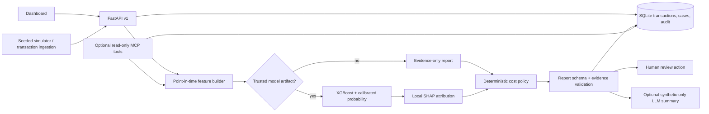

# Architecture and quantitative methodology



```mermaid
sequenceDiagram
  actor Analyst
  participant UI as Dashboard
  participant API as FastAPI
  participant DB as SQLite
  participant Tools as Typed local tools
  participant Model as Research model (optional)
  Analyst->>UI: Select synthetic or ingested transaction
  UI->>API: POST /api/v1/investigations
  API->>DB: Retrieve current event and earlier history
  API->>Tools: Compute velocity, deviation, network statistics
  Tools-->>API: Values and source transaction IDs
  alt Compatible artifact loaded
    API->>Model: Transform ordered features and predict
    Model-->>API: Calibrated probability, model version, latency
    API->>Model: Calculate SHAP contributions
  else Artifact missing
    API-->>API: Leave probability and attribution unavailable
  end
  API->>API: Apply deterministic policy and validate report/evidence
  API->>DB: Persist report and stage audit events
  API-->>UI: Structured evidence report; human review required
  Analyst->>UI: Accept, dismiss, or escalate
  UI->>API: POST /api/v1/cases/{id}/review
  API->>DB: Persist disposition and audit entry
```

## Deterministic versus generated outputs

Feature values, calibrated model probability, SHAP values, decision thresholds, costs, and audit timestamps are computed or loaded locally. A model probability is not an operational risk score; RiskLens displays the probability separately and uses demo policy bands only for presentation. SHAP values are model attribution, not proof or causality.

The investigation workflow is a bounded explicit sequence, not an autonomous agent loop. All evidence tools are registered, typed, and read-only. The optional MCP server exposes a small allow-listed subset and cannot run SQL, access files, call financial services, or change decisions. The optional OpenAI-compatible adapter can only summarize computed evidence from simulator records; it cannot set a probability or recommendation, and output must visibly cite known evidence IDs. Numeric and decisive fraud/action language is rejected. These lexical checks improve traceability but do not prove semantic entailment, so summaries remain advisory and the deterministic evidence stays primary. Offline reports use deterministic templates.

## Feature construction

The ordered fields and transformations are documented in `app/features.py` and `docs/research-foundation.md`. RiskLens uses the versioned `risklens-causal-v2` online feature contract. It shares field names with the pinned research pipeline but deliberately does not accept its incompatible HHI artifact. For event (i) at time (t_i), history windows end strictly before (t_i):

\[
N_{24h}(i)=\sum_j \mathbf{1}[a_j=a_i, c_j=c_i, t_i-24h\le t_j<t_i]
\]

The sender amount z-score uses the prior 30-day sample mean and sample standard deviation. The prior receiver count/sum, sender time since previous event, lifetime degree/counts, pair frequency, and sender counterparty value-share HHI use historical rows only. Entity identifiers are retained only to construct history and never passed into the trained estimator; labels and laundering typology are never accepted as model inputs.

## Rare-event evaluation

- Precision (TP/(TP+FP)), recall (TP/(TP+FN)); at a fixed alert capacity the selected transactions are the stable top-K probabilities.
- PR-AUC summarizes the precision-recall curve and is informative under rare positives; its baseline depends on prevalence.
- ROC-AUC measures pairwise ranking across positive/negative pairs but can look strong when negatives dominate.
- The Brier score is mean squared probability error; log loss penalizes confident errors. The source model fits calibration on a chronological calibration period, selects the alert threshold on a later validation period, then reports held-out test results.
- Operational cost simulation has no outcome labels. For probability (p), assumed missed-event cost (C_m), false-positive cost (C_f), manual review cost (C_r), and assumed review effectiveness (e=0.8):

\[
L_{allow}=pC_m,\qquad L_{review}=C_r+(1-p)C_f+p(1-e)C_m.
\]

The service recommends review only when both the configured/model alert threshold and cost break-even rule allow it. The effective threshold is the larger of those values; the report identifies which bound determined the action. This constrained policy assumes known calibrated (p), constant user-defined cost units, and fixed review effectiveness. It excludes loss severity distributions, action spillovers, capacity queues, and realized business outcomes; figures are hypothetical expected costs, not measured savings. At a population size of (N), alert capacity is `ceil(N × budget)`, with a minimum of one.

## Monitoring and evaluation boundaries

Latency percentiles are calculated from persisted inference calls in the local database. Drift compares an actual score window with artifact validation score quantiles, requiring at least 20 observations. The alert threshold is a demo PSI cutoff of 0.2. Score drift does not establish model degradation. Supervised metrics are not computed without adjudicated labels.
